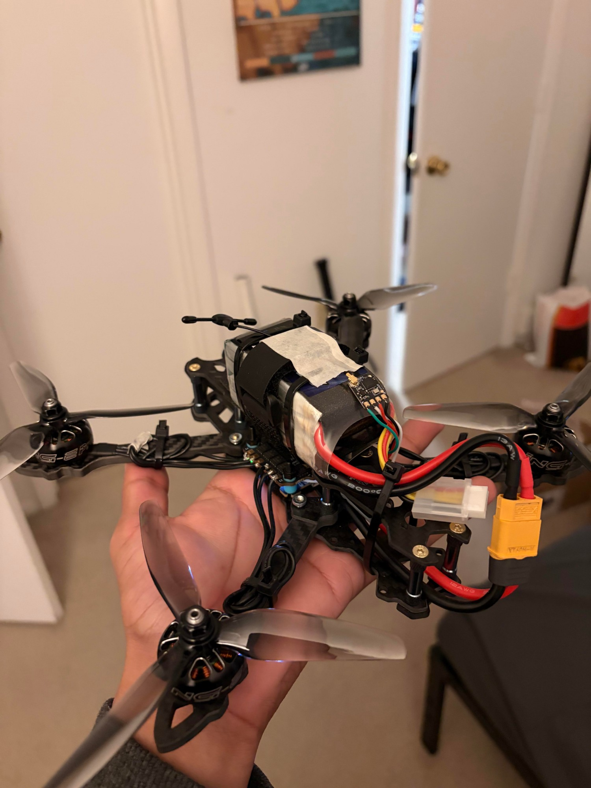
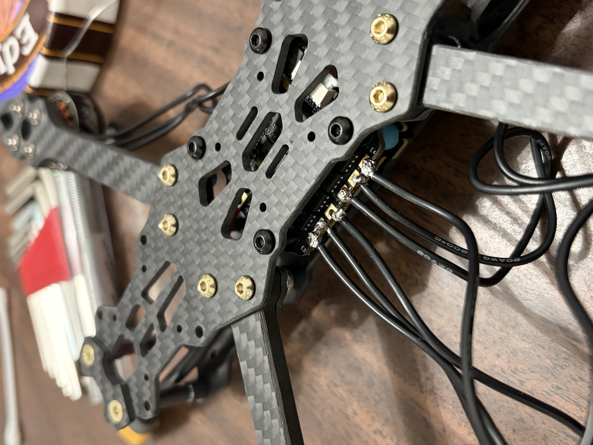
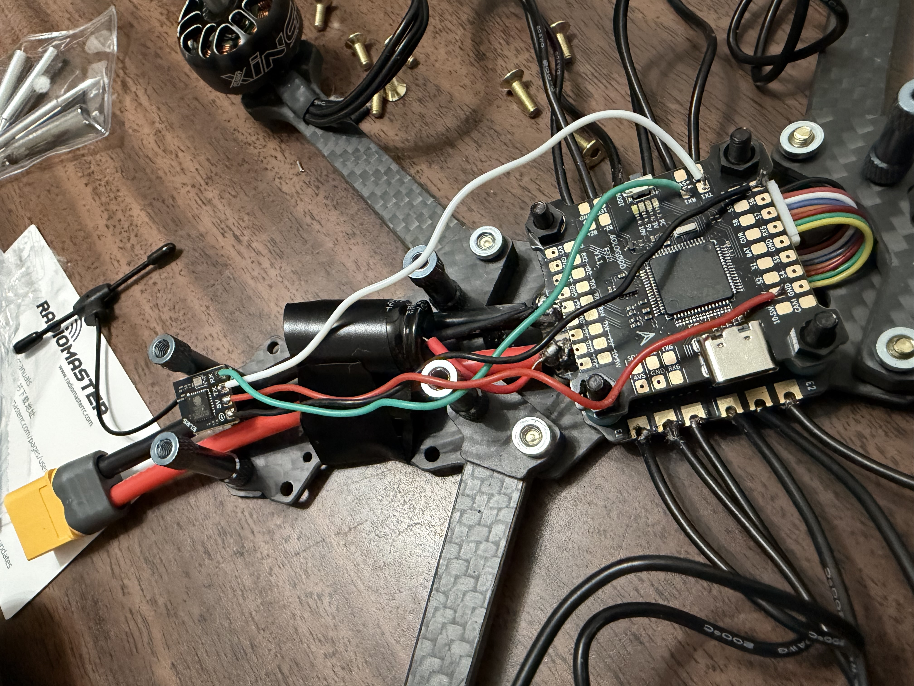

# Racing Drone 🛸

> Custom 5" racing quad. Built, configured, and **flown for the first time**.
> **Status:** it flies, but it doesn't hover steadily yet. Working through setup fixes and stick time before tuning and autonomy.

<p align="center">
  
</p>

---

## ⚡ at a glance

| | |
|---|---|
| **Build start** | April 2026 |
| **Frame size** | 5" (225mm) |
| **Battery config** | 4S |
| **Firmware** | Betaflight 2026.6.2 (cloud build, GPS enabled) |
| **Current phase** | First flights + stabilization fixes |
| **Next milestone** | Steady hover in Angle mode |
| **Long-term goal** | Autonomy (GPS assist → H743 + ArduPilot + ROS 2) |

---

## 🔧 Bill of Materials (BOM)

### Drone hardware
| Component | Part | Notes |
|---|---|---|
| **Frame** | FPVDrone 225mm Carbon Fiber Freestyle Frame Kit | 5" quad, includes lipo battery strap |
| **Motors** | iFlight XING-E Pro 2207 2450KV (×4) | Brushless, 4S |
| **FC + ESC Stack** | SoloGood F722 FC + 4-in-1 60A BLS8 ESC | 30.5×30.5mm, dual BEC 5V/10V |
| **Receiver** | RadioMaster RP1 ELRS Nano (2.4GHz) | 65mm UFL T-antenna |
| **Props** | HQProp Ethix S5 Light Grey 5×4×3 (16pcs) | Tri-blade, 4S/6S compatible |
| **Connectors** | ZHOFONET XT60 (M+F, 12AWG) | 3 pairs w/ 5cm silicone wire |
| **Cable mgmt** | Skalon 8" Zip Ties (100 pack, 40lbs) | — |

### Radio / control
| Component | Part | Notes |
|---|---|---|
| **Transmitter** | Radiomaster Pocket (ELRS, Mode 2) | Hall gimbals, foldable antenna |

### Power / charging
| Component | Part | Notes |
|---|---|---|
| **Battery** | Zeee 4S 1500mAh 14.8V 120C Graphene LiPo (×2) | XT60 plug |
| **Charger** | ISDT 608PD Smart Charger | DC 240W / USB-C 100W, 1–6S LiPo |
| **LiPo safety** | Tenergy Fire-Retardant LiPo Bag (7×9") | For charging + storage |

### Tools
| Component | Part | Notes |
|---|---|---|
| **Soldering Iron** | 80W 110V LCD Digital Soldering Kit | 5 tips, stand, solder wire, paste, sponge |

### Planned
| Component | Part | Notes |
|---|---|---|
| **GPS + compass** | M10 GPS module with magnetometer | For GPS Rescue, altitude hold, position hold |
| **Autonomy FC** | H743 flight controller | Needed for ArduPilot (F722 doesn't have enough flash) |

> Estimated build cost so far: **~$550** (drone hardware + tools)

---

## 🛠️ config & setup log

*Tracking the software/firmware side of the build.*

- [x] Flash Betaflight to SoloGood F722 (2026.6.2, full chip erase)
- [x] Configure ports: Serial RX on UART1, CRSF protocol
- [x] Fix receiver wiring: RP1 TX/RX crossed to FC RX1/TX1, power moved to a 5V pad
- [x] Bind RadioMaster RP1 receiver to Pocket TX
- [x] Motor protocol DSHOT600, 4 kHz PID loop, 14 motor poles
- [x] Arming switch
- [x] First flight 🎉 (unstable, see below)
- [ ] Angle mode on, accelerometer calibrated
- [ ] Throttle curve + throttle limit
- [ ] Steady hover
- [ ] Flash Bluejay on the ESC + turn on bidirectional DShot (RPM filter)
- [ ] Blackbox logging
- [ ] PID tuning from blackbox logs

---

## ✈️ first flight (Nov 2026)

It flew! It was also really hard to control:

- **It changed direction on its own.** It drifted off without any stick input.
- **It bounced,** both in the air and on landing.
- **The throttle was all or nothing.** It either shot up or dropped straight down, and there was almost no point where it just hovered.
- **It was very hard to keep in one place.**

### what was going on

| Symptom | Likely cause |
|---|---|
| Drifting / changing direction | It was flying in **Acro mode**. The full chip erase cleared every mode except ARM, and Acro never levels the quad by itself. The **accelerometer calibration was also wiped**, so even Angle mode would drift. |
| Shoots up / drops | A 5" quad on 4S hovers at only ~25–35% throttle, and the Pocket's throttle stick has no spring. A tiny stick movement makes a big change in thrust. |
| Bouncing | **Airmode** keeps the motors pushing at low throttle, which makes landings bouncy. Loose props, a shifting battery, or the default PIDs on an unfiltered setup (no RPM filter yet) can add wobble. |
| Can't hold position | Expected. Angle mode only keeps the quad level. It doesn't hold altitude or position, so the pilot still corrects drift. |

### the fix plan

**1. Flight mode + sensors** (props off)
- Modes tab: put **ANGLE** on the full 900–2100 range so it's always on while learning.
- Setup tab: **calibrate the accelerometer** on a flat surface, then tilt the quad by hand and make sure the 3D model follows.
- Center the roll and pitch trims on the Pocket. Receiver tab should read ~1500 with the sticks centered.

**2. Throttle** (CLI)
```
set thr_mid = 30
set thr_expo = 40
set throttle_limit_type = SCALE
set throttle_limit_percent = 80
save
```

**3. Bounce**
- Turn **Airmode off** for now.
- Check props are tight and on the right motors, and the motor screws are snug.
- **Mount the receiver to the frame.** Right now the RP1 is taped to the battery (see photo), so it moves every time the pack is swapped and the wires get tugged.
- Strap the battery tight and centered so the center of gravity doesn't shift in flight.
- If it still shakes in the air, drop the PID master slider one notch.

**4. Stick time**
- Practice hovering in a simulator (Liftoff / Velocidrone / Uncrashed) with the Pocket as a USB joystick.
- Next real flights: Angle mode, over grass, low, hover only.

---

## 🗺️ roadmap

PID tuning and autonomy only work on a quad that already flies cleanly, so the order matters:

1. **Steady hover** in Angle mode (fixes above)
2. **Bluejay + bidirectional DShot** → RPM filter cleans up motor noise
3. **Blackbox logging** → real flight data
4. **PID tuning** from logs (PIDtoolbox / Blackbox Explorer). This sets how hard and fast the FC corrects errors, so a good tune means less wobble, less bounce-back, cooler motors, and a solid base for the hold modes.
5. **GPS pilot assist** on the current F722: add the M10 GPS + compass, then GPS Rescue, **altitude hold** and **position hold**. This needs ALTHOLD/POSHOLD enabled in the firmware build.
6. **Real autonomy:** the F722 only has ~512 KB of flash, which rules out ArduPilot and PX4. The plan is to swap to an **H743 FC running ArduPilot**, which adds waypoint missions, EKF3 state estimation, MAVLink and ROS 2.
   - Start early in **ArduPilot SITL + Gazebo + ROS 2** on a laptop, so the software is ready before the hardware.
   - Validate my own state estimation (robot_localization) against ArduPilot's EKF3 using flight logs.
   - Later: a companion computer (Raspberry Pi / Jetson) for offboard control.

---

## 📓 build notes

### Soldering the ESC + power leads
First time soldering on a 4-in-1 ESC. Took a few attempts to get clean joints — flux is your friend.

<p align="center">
  
</p>

### Receiver wiring
The original wiring had RP1 TX → FC TX, so the FC never saw the receiver. TX and RX have to **cross** (RX TX → FC RX1, RX RX → FC TX1). The receiver was also moved to a 5V pad. It only powers up with a LiPo plugged in, not over USB.

<p align="center">
  
</p>

*(Photo shows the original receiver wiring, before the fix.)*

---

## 💡 lessons learned

- **Soldering takes practice.** First few joints looked rough. More flux, more heat, less solder than you'd think.
- **Plan your wire routing before you solder.** Cut wires too short the first time and had to redo a joint.
- **Tin everything first.** Pre-tin pads + wire ends → joints come out way cleaner.
- **Check motor wire order before final mounting.** Motor direction in Betaflight is easier to fix in software, but knowing CW/CCW up front saves headaches.
- **LiPo safety isn't optional.** Always charge in the bag. Always.
- **UART TX goes to RX.** Serial lines always cross.
- **A full chip erase wipes *everything*.** Modes, accelerometer calibration, all of it. Redo the setup checklist after flashing, not just the ports.
- **Know what mode you're flying in.** Acro on a first flight feels like the drone has a mind of its own. Learn in Angle mode first.
- **Fly well before tuning, tune before automating.** PIDs and autonomy can't fix a setup problem or a lack of stick time.

---

## 📫 contact

Neal Mehta — Mechanical Engineering @ Virginia Tech
[LinkedIn](https://linkedin.com/in/your-handle) · neal4146 on GitHub
